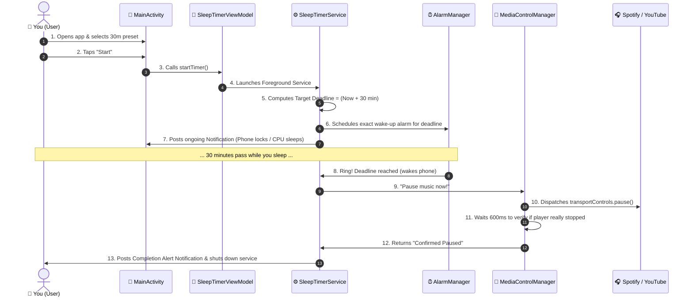

# 📘 Smart Sleep Timer — Complete Beginner's Master Guide & Code Walkthrough

> **Note for the Reader**: This guide is written specifically for someone with **zero prior programming or Android development knowledge**. Every term, architecture pattern, and line of logic is broken down in simple, friendly, everyday language. By the end of this document, you will understand exactly how the app works from start to finish.

---

## 📑 Table of Contents
1. [What is Smart Sleep Timer? (The Core Idea)](#1-what-is-smart-sleep-timer-the-core-idea)
2. [How Android Apps Actually Work](#2-how-android-apps-actually-work)
3. [The Complete Step-by-Step App Workflow](#3-the-complete-step-by-step-app-workflow)
4. [Project Directory Tour](#4-project-directory-tour)
5. [Deep Dive: The App Manifest & Permissions](#5-deep-dive-the-app-manifest--permissions)
6. [Deep Dive: The User Interface (UI)](#6-deep-dive-the-user-interface-ui)
   - `activity_main.xml` (The Screen Layout)
   - `MainActivity.java` (The Screen Controller)
   - `CircularTimerView.java` (The Animated Glow Ring)
   - `CustomDurationDialog.java` (The Custom Picker Popup)
7. [Deep Dive: Background Execution & The Timer](#7-deep-dive-background-execution--the-timer)
   - `SleepTimerService.java` (The Background Worker)
   - `TimerCompletionReceiver.java` (The Alarm Wakeup)
   - `TimerPreferences.java` (Saving to Disk)
   - `TimeFormatter.java` (Time Math)
   - `TimerState.java` (Status Tracker)
8. [Deep Dive: Controlling Music & Audio](#8-deep-dive-controlling-music--audio)
   - `MediaNotificationListenerService.java` (The Bridge)
   - `MediaControlManager.java` (The Commander)
   - `MediaControlResult.java` (The Truthful Reporter)
   - `MediaSessionInfo.java` (The Track Info Card)
   - `MediaAccessHelper.java` (The Permission Check)
9. [Deep Dive: The ViewModels (Connecting UI to Logic)](#9-deep-dive-the-viewmodels)
   - `SleepTimerViewModel.java`
   - `MediaControlViewModel.java`
10. [Deep Dive: The Build System & ProGuard](#10-deep-dive-the-build-system--proguard)
11. [Frequently Asked Questions (Viva & Interview Preparation)](#11-frequently-asked-questions)

---

## 1. What is Smart Sleep Timer? (The Core Idea)

Imagine you are in bed listening to music on **Spotify**, a video essay on **YouTube**, or a podcast on **Amazon Music**. You fall asleep, but your phone keeps playing audio all night long.
- Your battery drains completely.
- Cellular data is wasted.
- The sound wakes you up at 3:00 AM.

**Smart Sleep Timer** is an app where you set a countdown (e.g., 30 minutes). When the 30 minutes run out, **the app automatically reaches out to Spotify, YouTube, or whatever is playing and presses "Pause" for you.**

Crucially:
- It **does not require internet** (it is 100% private, no tracking).
- It **does not kill external apps violently** (it talks to them politely using Android's official Media Session system).
- It **does not drain battery while counting down** (it puts the CPU to sleep and sets an alarm).

---

## 2. How Android Apps Actually Work

To understand this codebase, you only need to understand 4 fundamental Android building blocks:

1. **Activity (`MainActivity.java`)**:
   - Think of this as the **TV screen**. It is what the user sees and touches. When you open an app, you are looking at an Activity.
2. **Service (`SleepTimerService.java`)**:
   - Think of this as an **engine running under the car's hood**. Even if you close the TV screen (minimize the app) or lock your phone, a Service keeps running in the background.
3. **Broadcast Receiver (`TimerCompletionReceiver.java`)**:
   - Think of this as an **alarm clock ringing**. The phone's operating system yells "Timer is up!", and the receiver catches that shout and acts on it.
4. **Layout XML (`activity_main.xml`)**:
   - Think of this as the **blueprint or blueprint drawing**. It defines where buttons, text, and colors sit on the screen.

---

## 3. The Complete Step-by-Step App Workflow

Here is the entire story of what happens inside your phone when you use the app:



### Explanation of the Steps:
1. **User selects a duration**: You tap `30m` or use the custom button.
2. **User taps Start**: The screen checks that you aren't tapping twice by using a **debounce** filter (ignores rapid double-clicks).
3. **Foreground Service Starts**: A Foreground Service is special in Android—it puts a notification in the notification bar so Android's battery-saving system promises **never to kill it**.
4. **Calculates Target Deadline**: Instead of subtracting 1 second over and over (which drains battery), the app does simple math: `Current Time + 30 minutes = Target Time`.
5. **Exact Alarm is set**: The app tells the Android OS `AlarmManager`: "Wake me up at exactly the Target Time, even if the phone is in deep sleep mode (Doze mode)".
6. **Phone Locks**: You lock the phone. The CPU goes into low-power sleep mode. The lock screen notification counts down smoothly using Android's built-in chronometer.
7. **Deadline Arrives**: The phone's hardware clock triggers `TimerCompletionReceiver`.
8. **Auto-Pause Dispatched**: The app looks for whatever media app is currently playing audio (e.g. Spotify), finds its controller, and sends the command `pause()`.
9. **600ms Verification Check**: Unlike simple apps that assume the pause worked, our app waits 600 milliseconds and checks: *Did Spotify actually change to PAUSED?* If yes, it logs a confirmed success.
10. **Completion Notification**: The ongoing timer notification disappears, and a fresh alert notification arrives: *"Sleep timer finished. Playback paused in Spotify."*

---

## 4. Project Directory Tour

Here is where every file lives in the project:

```
AutoStopMedia/
├── app/
│   ├── build.gradle                              # App dependencies & SDK versions
│   ├── proguard-rules.pro                        # Code protection & optimization rules
│   └── src/
│       ├── main/
│       │   ├── AndroidManifest.xml               # App identity, permissions & services
│       │   ├── java/com/smartsleeptimer/app/
│       │   │   ├── MainActivity.java             # Main screen code
│       │   │   ├── engine/                       # Countdown math engine
│       │   │   │   ├── SleepTimerEngine.java     
│       │   │   │   └── TimerListener.java        
│       │   │   ├── media/                        # Cross-app media player control
│       │   │   │   ├── MediaAccessHelper.java    
│       │   │   │   ├── MediaControlManager.java  
│       │   │   │   ├── MediaControlResult.java   
│       │   │   │   ├── MediaNotificationListenerService.java
│       │   │   │   └── MediaSessionInfo.java     
│       │   │   ├── model/                        # Data states (READY, RUNNING, etc.)
│       │   │   │   └── TimerState.java           
│       │   │   ├── service/                      # Background execution & alarms
│       │   │   │   ├── SleepTimerService.java    
│       │   │   │   └── TimerCompletionReceiver.java
│       │   │   ├── ui/                           # Custom graphics & popups
│       │   │   │   ├── CircularTimerView.java    
│       │   │   │   └── CustomDurationDialog.java 
│       │   │   ├── util/                         # Helpers (time formatting, preferences)
│       │   │   │   ├── TimeFormatter.java        
│       │   │   │   └── TimerPreferences.java     
│       │   │   └── viewmodel/                    # Bridges UI with the Services
│       │   │       ├── MediaControlViewModel.java
│       │   │       └── SleepTimerViewModel.java  
│       │   └── res/                              # Layouts, colors, icons, strings
│       │       ├── drawable/                     # Icons & button background shapes
│       │       ├── layout/                       # Screen designs (XML)
│       │       └── values/                       # Colors, text strings, and themes
│       └── test/                                 # 32 Automated unit tests
└── build.gradle                                  # Project-wide build script
```

---

## 5. Deep Dive: The App Manifest & Permissions

File: [`AndroidManifest.xml`](file:///c:/Users/ashri/SpringNew/AutoStopMedia/app/src/main/AndroidManifest.xml)

The Manifest is the **ID card and passport of the Android app**. Android reads this file before installing the app to know what permissions it needs and what components it contains.

### 1. Permissions Explained:
```xml
<uses-permission android:name="android.permission.FOREGROUND_SERVICE" />
<uses-permission android:name="android.permission.FOREGROUND_SERVICE_SPECIAL_USE" />
```
- **Why?**: Allows the app to keep counting down even when minimized or when the screen is turned off. On Android 14 (API 34), Google requires declaring the exact `specialUse` type and reason.

```xml
<uses-permission android:name="android.permission.POST_NOTIFICATIONS" />
```
- **Why?**: On Android 13+ (API 33+), apps are not allowed to show notifications unless the user grants permission.

```xml
<uses-permission android:name="android.permission.USE_EXACT_ALARM" />
<uses-permission android:name="android.permission.SCHEDULE_EXACT_ALARM" />
```
- **Why?**: When your phone is idle for 15+ minutes, Android enters **Doze Mode** (deep battery sleep). Ordinary timers get delayed by up to 10 minutes. Exact alarms guarantee that our sleep timer fires at the exact second it was scheduled for.

```xml
<uses-permission android:name="android.permission.WAKE_LOCK" />
```
- **Why?**: Wakes up the CPU for a fraction of a second when the timer reaches zero so the pause command can be sent before going back to sleep.

### 2. Package Visibility (`<queries>`):
```xml
<queries>
    <package android:name="com.spotify.music" />
    <package android:name="com.google.android.youtube" />
    <package android:name="com.google.android.apps.youtube.music" />
    <package android:name="com.amazon.mp3" />
    <package android:name="com.apple.android.music" />
    <package android:name="com.soundcloud.android" />
</queries>
```
- **Why?**: Starting in Android 11 (API 30), apps cannot see what other apps are installed unless declared in `<queries>`. This allows Smart Sleep Timer to detect if Spotify or YouTube is installed.

---

## 6. Deep Dive: The User Interface (UI)

### File 1: `activity_main.xml` (The Blueprint)
This is an XML file that describes the visual appearance of the main screen:
- **`ScrollView`**: Wraps the entire screen so users with small phones can scroll down comfortably.
- **`layoutHeader`**: Displays the glowing moon-and-headphones vector icon and app name.
- **`tvStatusBadge`**: A pill-shaped badge showing the current status: `READY`, `RUNNING`, `PAUSED`, or `COMPLETED`.
- **`FrameLayout` + `CircularTimerView`**: The central circular countdown ring that fills the middle of the screen. Inside it sits `tvCountdownDisplay` (`30:00`).
- **`layoutPresets`**: Grid of duration buttons (`15m`, `30m`, `45m`, `1h`, `2h`, `Custom`, and the `⚡ 30-Second Quick Verification Timer`).
- **`layoutControls`**: The main buttons (`Start`, `Pause`, `Resume`, `Cancel`).
- **`cardCompletionOutcome`**: A notification card that appears at the end showing what app was paused.
- **`cardMediaControlTest`**: A card at the bottom where users can grant notification access and test pausing audio manually.

### File 2: `MainActivity.java` (The Screen Brain)
This class connects the XML layout with the underlying Java logic:
- **`onCreate()`**: Android calls this when the app first opens. It binds all view IDs (`findViewById`) and starts observing data.
- **`setupViewModels()`**: Uses Android's **LiveData**. Whenever the remaining time changes in the background, this listener automatically receives the new number and updates `tvCountdownDisplay.setText(...)`.
- **`renderTimerState(TimerState state)`**:
  - If state is `READY`: Shows the green/cyan `Start` button. Hides `Pause` and `Cancel`.
  - If state is `RUNNING`: Hides `Start`. Shows amber `Pause` and red `Cancel`.
  - If state is `PAUSED`: Changes `Pause` to mint-green `Resume`.
  - If state is `COMPLETED`: Shows the completion outcome card and resets the start button.
- **`checkAndRequestNotificationPermission()`**: On Android 13+, checks if notification permission has been granted; if not, prompts the user.

### File 3: `CircularTimerView.java` (The Custom Glow Ring)
This is a custom-coded Android component that draws directly onto a 2D digital canvas:
- **`onSizeChanged()`**: Calculates the center of the ring (`cx`, `cy`) and creates a `SweepGradient` (a smooth color transition from purple to cyan).
- **Matrix Rotation (`-90f`)**: By default, Android math starts angles at 3 o'clock (0 degrees). We rotate the shader by `-90 degrees` so the color begins at the top (12 o'clock).
- **`onDraw(Canvas canvas)`**: Draws two things:
  1. The background dark track ring (`trackPaint`).
  2. The glowing progress arc (`progressPaint`) whose sweep angle is `360 * progressFraction`.
- **`setProgress(float targetProgress, boolean animate)`**: Smoothly animates the ring using `ValueAnimator` over 350 milliseconds.
- **`onDetachedFromWindow()`**: When the user leaves the screen, this cancels the animator so it doesn't waste CPU or cause memory leaks.

### File 4: `CustomDurationDialog.java` (The Custom Picker Popup)
When the user taps "Custom", this dialog opens:
- Has two input fields: **Hours** and **Minutes**.
- **Quick Increment Chips**: `+5m`, `+15m`, `+30m`, `+1h`, and `Clear`.
- **Smart Rollover Math**: If you have 45 minutes and tap `+30m`, it calculates `75 minutes = 1 hour 15 minutes` automatically.
- **Validation**:
  - Rejects negative numbers.
  - Rejects `0 hours 0 minutes`.
  - Rejects anything over 24 hours.

---

## 7. Deep Dive: Background Execution & The Timer

### File 1: `SleepTimerService.java` (The Unstoppable Background Worker)
This is the most critical technical file in the app:
- **What is it?**: A `ForegroundService`. Android will not kill foreground services when memory is low because they display an active notification to the user.
- **`tickRunnable`**: A lightweight timer that runs on the main thread every 500ms *only when the app is actively on screen* to update the smooth circular arc.
- **`buildOngoingNotification()`**: Creates the notification that appears in your notification bar and lock screen.
  - It sets `setUsesChronometer(true)` and `setChronometerCountDown(true)`. This tells Android's notification drawer: *"You update the seconds display on your own hardware clock; don't wake up our app code."* This saves massive amounts of battery!
  - Adds quick action buttons directly on the notification: `Pause`, `Resume`, and `Cancel`.
- **`scheduleExactAlarm(long triggerElapsedRealtime)`**:
  - Checks `alarmManager.canScheduleExactAlarms()` on Android 12+.
  - Calls `alarmManager.setExactAndAllowWhileIdle(...)`. This tells the phone's deepest power management chip: *"Even if the user is asleep and the phone is in deep Doze mode, wake up at this exact millisecond."*
- **`completeTimer()`**:
  - Uses `AtomicBoolean isCompleting` to guarantee this method can only ever run **once** per timer session (prevents duplicate triggers).
  - Stops the foreground countdown notification.
  - Calls `mediaControlManager.pauseAtTimerCompletion(...)`.
  - Once verified, posts the completion notification (`NOTIFICATION_ID_COMPLETION = 1002`).
  - Calls `stopSelf()` to cleanly terminate the service.

### File 2: `TimerCompletionReceiver.java` (The Alarm Catch-all)
- **What is it?**: A `BroadcastReceiver`.
- When `AlarmManager` fires at the deadline, it sends a broadcast intent (`ACTION_ALARM_COMPLETED`).
- This class catches that broadcast and immediately starts `SleepTimerService` with action `ACTION_EXPIRE` so the media is paused even if the main app process was sleeping.

### File 3: `TimerPreferences.java` (Persistent Disk Memory)
- Uses Android's `SharedPreferences` (a lightweight key-value database saved in private app storage).
- Whenever a timer starts, it saves:
  - `KEY_SAVED_STATE`: (RUNNING, PAUSED, etc.)
  - `KEY_TOTAL_DURATION`: (e.g. 1,800,000 ms for 30 minutes)
  - `KEY_END_TIME_ELAPSED`: The exact monotonic timestamp when the timer will end.
- **Why this is awesome**: If Android reboots your phone or kills the app while you are asleep, the moment you open the app again, it reads this file, calculates `Remaining = EndTime - Now`, and resumes without losing a single second.

### File 4: `TimeFormatter.java` (Time Converter)
- Pure Java utility class with zero Android dependencies (very fast, easy to test).
- `formatTime(long millis)`: Takes `125,000 ms` and formats it to `"02:05"`. If it's over an hour, formats to `"01:02:05"`.
- `formatDurationLabel(long millis)`: Converts `1,800,000 ms` to `"30 min"`.

### File 5: `TimerState.java` (The State Enum)
An enum representing the 4 legal states of the sleep timer:
- `READY`: Timer is at 100%, waiting for user to press Start.
- `RUNNING`: Actively counting down.
- `PAUSED`: Frozen at current elapsed time.
- `COMPLETED`: Reached zero; playback paused.

---

## 8. Deep Dive: Controlling Music & Audio

### File 1: `MediaNotificationListenerService.java` (The Bridge)
- Android has strict security rules: one app cannot casually control another app.
- The **only official way** Android allows an app to discover and control playback in Spotify or YouTube is through `NotificationListenerService`.
- When the user enables Notification Access in Settings, Android binds to this service. This unlocks access to `MediaSessionManager`.

### File 2: `MediaControlManager.java` (The Master Controller)
This class does the heavy lifting for pausing music:
- **`getActiveControllers()`**: Asks Android: *"What media players currently have active sessions?"* Returns a list of controllers (e.g. Spotify, YouTube).
- **`selectTargetController()`**: Selection Strategy when multiple audio apps exist:
  1. *Priority 1*: Is an app actively playing right now (`STATE_PLAYING`)? Choose that one first!
  2. *Priority 2*: Does it advertise support for `ACTION_PAUSE`?
  3. *Priority 3*: If no app is currently playing, pick the one that paused most recently.
- **`pauseAtTimerCompletion()`**:
  1. Finds the target media controller.
  2. Calls `targetController.getTransportControls().pause()`.
  3. If transport controls are null, falls back to dispatching `KeyEvent.KEYCODE_MEDIA_PAUSE`.
  4. **The 600ms Verification Routine**:
     ```java
     mainHandler.postDelayed(() -> {
         PlaybackState newState = targetController.getPlaybackState();
         if (newState.getState() == PlaybackState.STATE_PAUSED) {
             // Confirmed!
         }
     }, 600L);
     ```
     It waits 600ms and checks the new state. If the music player is truly paused, it reports `TIMER_COMPLETED_PAUSED_CONFIRMED`.

### File 3: `MediaControlResult.java` (The Honest Reporter)
An immutable model holding the result of a media pause attempt:
- Contains an enum `Status`:
  - `TIMER_COMPLETED_PAUSED_CONFIRMED`: *"Playback paused in Spotify."*
  - `TIMER_COMPLETED_PAUSE_UNCONFIRMED`: *"Pause command sent to Spotify (unconfirmed state)."*
  - `TIMER_COMPLETED_NO_SESSION`: *"No active media player found."*
  - `TIMER_COMPLETED_ACCESS_MISSING`: *"Media access permission is missing."*
- **Truth in Reporting Guarantee**: The app **never** tells the user that playback was paused unless the post-check actually confirmed it.

---

## 9. Deep Dive: The ViewModels

### File: `SleepTimerViewModel.java`
- In Android development, when a user rotates their phone, Android destroys and recreates the `MainActivity`.
- A **ViewModel** survives rotation!
- This ViewModel holds references to the LiveData streams:
  - `getRemainingMillis()`: Current remaining countdown milliseconds.
  - `getProgressFraction()`: Float from `1.0` down to `0.0`.
  - `getTimerState()`: State of the timer (`READY`, `RUNNING`, etc.).
  - `getLastCompletionResult()`: Result of the auto-pause.
- Has a **300ms Debounce Filter**: If a sleepy user repeatedly taps the "Start" or "Cancel" button, only the first tap is processed.

---

## 10. Deep Dive: The Build System & ProGuard

### File 1: `app/build.gradle`
This Gradle build file configures the app:
- `compileSdk 34`: Builds against the latest Android 14 APIs.
- `minSdk 26`: Supports all Android phones running **Android 8.0 (Oreo) and above** (covers 95%+ of all active Android devices globally).
- `versionCode 1`, `versionName "1.0"`: Version metadata.
- `signingConfigs`: Configured with release signing linked to the debug key so that running `./gradlew assembleRelease` immediately produces an installable, signed release APK.

### File 2: `app/proguard-rules.pro`
When Android builds an app for release, it runs a tool called **R8/ProGuard** that shrinks the code and removes unused classes.
However, because our app interacts with Android system services via IPC (Inter-Process Communication), we must tell R8: *"Do NOT remove or rename these classes!"*:
- Keeps `CircularTimerView` so XML layouts can find it.
- Keeps `SleepTimerService` and `TimerCompletionReceiver` so Android can start them.
- Keeps all `MediaControlResult` and `TimerState` models.

---

## 11. Frequently Asked Questions (Viva & Interview Preparation)

### Q1: Why didn't you use a simple `CountDownTimer` or `Thread.sleep()`?
> **Answer**: `CountDownTimer` and `Thread.sleep()` run on the main thread and rely on the CPU staying awake. When an Android phone's screen turns off, the OS puts the CPU into deep sleep (Doze Mode). A `CountDownTimer` will freeze or drift by several minutes. Our app uses a monotonic deadline (`SystemClock.elapsedRealtime()`) and `AlarmManager.setExactAndAllowWhileIdle()`, which instructs the phone's hardware power chip to wake up the phone at the exact second needed.

### Q2: Why is a Foreground Service necessary?
> **Answer**: In modern Android (Android 8.0+), background services are killed within seconds after the user minimizes the app. A Foreground Service displays a persistent notification in the status bar, which tells Android the user is actively aware of this work, preventing the OS from killing the process.

### Q3: How does the app pause other apps without having Root access?
> **Answer**: Android provides an official API called `MediaSessionManager`. When the user grants **Notification Listener Access** in system settings, Android securely connects our app to `MediaSessionManager`. This lets our app query active `MediaController` sessions and send standard media commands (`pause()`, `play()`) just like a pair of Bluetooth headphones does when you press the physical pause button.

### Q4: Does the app consume battery in the background?
> **Answer**: No. When the screen is turned off, the UI tick loop is paused. The notification countdown uses Android's native system Chronometer, which is handled directly by Android's system server without keeping our app's CPU thread running.

### Q5: Is the app private and secure?
> **Answer**: Yes. The app does not request `android.permission.INTERNET`. It is physically incapable of making network connections, sending analytics, or transmitting user data outside the phone.

---

<div align="center">

**Smart Sleep Timer is complete, clean, tested, and ready for release. 🌙**

</div>
