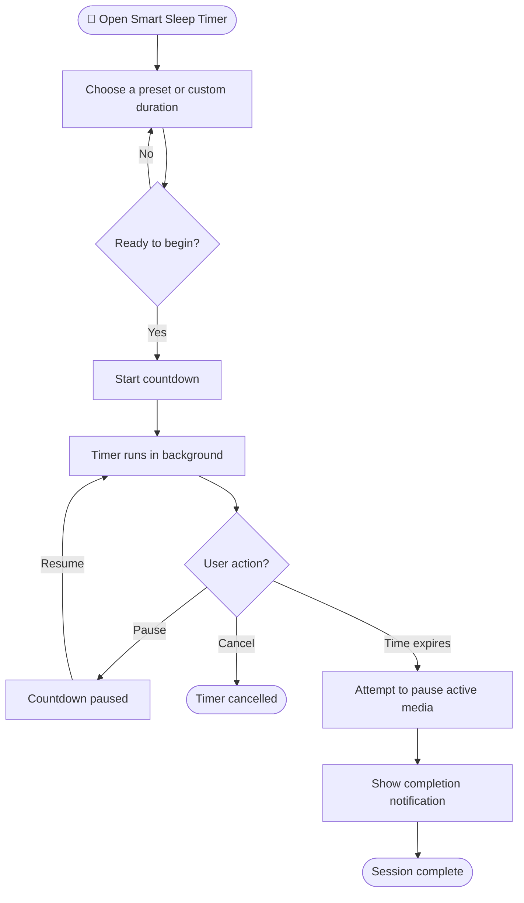
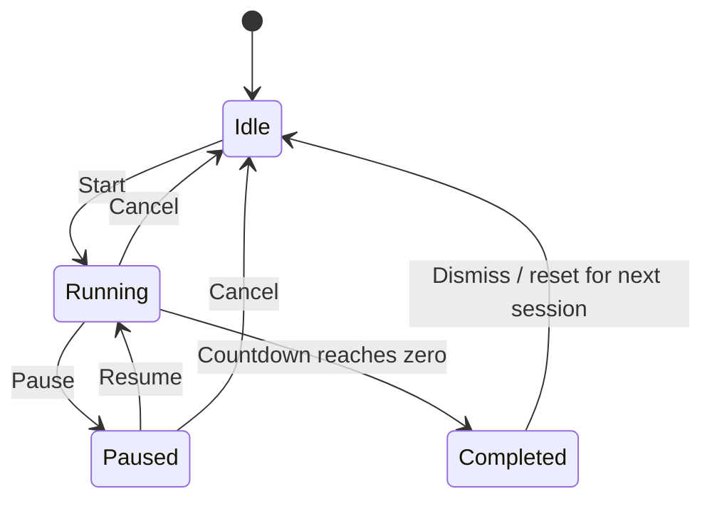
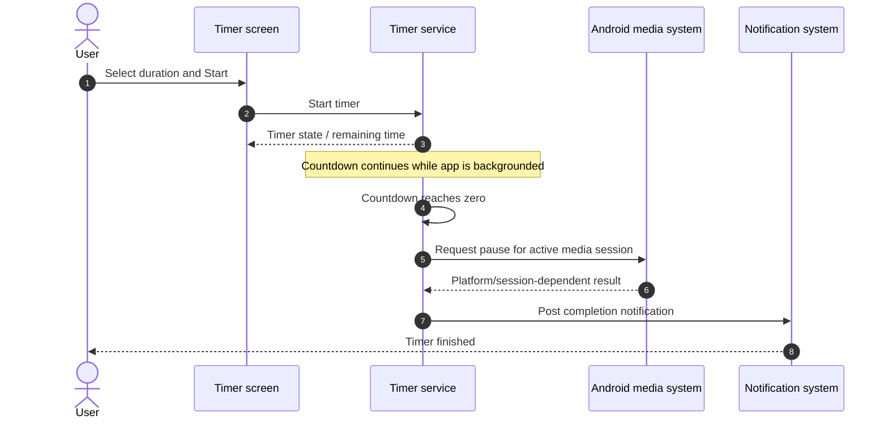
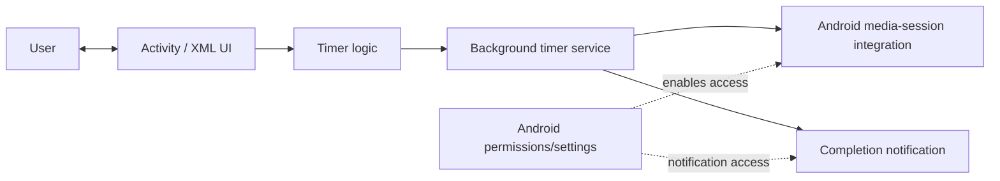
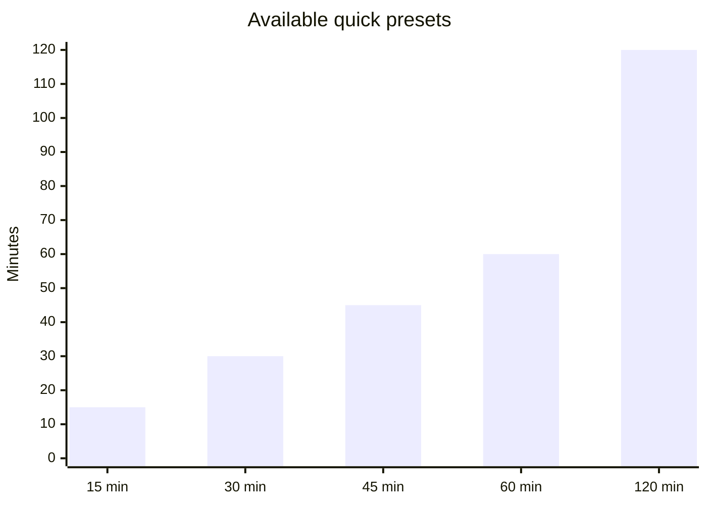
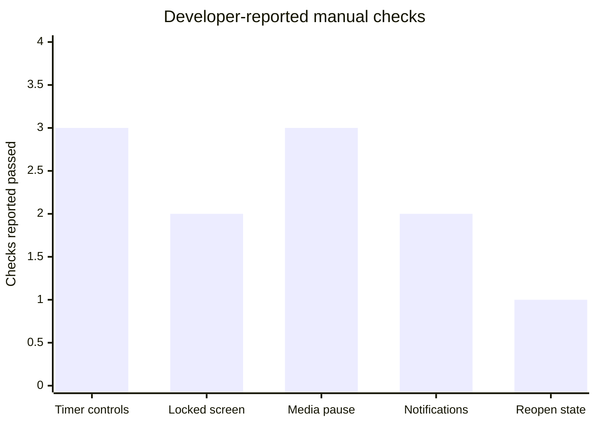
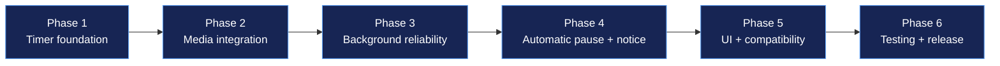

<div align="center">

# 🌙 Smart Sleep Timer

### Let your music wind down. Let yourself sleep.

A native Android sleep timer that counts down reliably, pauses supported media when the timer expires, and notifies you when the session is complete.

<p>
  
  
  
  
</p>

**A focused, offline-first Android project — no backend and no internet permission required.**

[Features](#-features) · [How it works](#-how-it-works) · [Permissions](#-permissions) · [Build](#-build-and-install) · [Test evidence](#-test-evidence) · [Roadmap](#-six-phase-build-journey)

</div>

---

## ✨ At a glance

| | |
|---|---|
| **App type** | Native Android application |
| **Implementation** | Java + XML layouts |
| **Build system** | Gradle / Android Studio |
| **Core workflow** | Select duration → start timer → media pauses at expiry |
| **Media integration** | Android media-session / notification-listener based integration |
| **Network dependency** | None required for the timer workflow |
| **Backend** | None |
| **Repository** | [Smart_Sleep-_Timer](https://github.com/ashrithBalaji456/Smart_Sleep-_Timer) |

> **Evidence note:** The test results in this README are recorded from the developer's reported manual tests on an iQOO Neo7 Pro running Android 16. They are not an independently audited test report. Add screenshots, screen recordings, and device/build details in the evidence section to make the results independently reviewable.

## 🚀 Features

- **Quick presets:** 15, 30, 45, 60, and 120 minutes.
- **Custom duration:** choose a timer duration for your own routine.
- **Timer controls:** Start, Pause, Resume, and Cancel.
- **Background countdown:** designed to continue while the screen is locked.
- **Media pause at expiry:** attempts to pause the active supported media session.
- **Completion notification:** alerts you when the timer finishes.
- **Permission-aware behavior:** handles notification permission denial and media-access setup.
- **No server required:** timer operation is local to the device.

## 🎬 How it works

### User journey



### Timer state model



### Expiry sequence



> Android media control depends on the active app/session, system version, and granted access. The app requests a pause; it cannot guarantee control of every possible player or device configuration.

## 🧭 Architecture



**Design principles**
- Keep the timer workflow local to Android.
- Separate the timer screen from background timing work.
- Use Android's permission and media-session mechanisms rather than a custom server.
- Treat media pause as a best-effort platform integration, not a universal guarantee.

## 📊 Timer presets



Presets are shortcuts; custom duration is available when a different interval is needed.

## 🧪 Test evidence

### Reported manual test matrix

The following results were reported by the developer during manual testing. Marked **PASS (reported)** means the developer says the check passed; it does not mean an external tester independently reproduced it.

| # | Test | Reported result |
|---:|---|---|
| 1 | App opens without crashing | PASS (reported) |
| 2 | Countdown starts and advances | PASS (reported) |
| 3 | Pause works | PASS (reported) |
| 4 | Resume works | PASS (reported) |
| 5 | Cancel works | PASS (reported) |
| 6 | Media access can be enabled | PASS (reported) |
| 7 | Manual media pause works | PASS (reported) |
| 8 | Countdown remains accurate with screen locked | PASS (reported) |
| 9 | Automatic pause at expiry works with Spotify | PASS (reported) |
| 10 | Automatic pause at expiry works with YouTube | PASS (reported) |
| 11 | Automatic pause at expiry works with Amazon Music | PASS (reported) |
| 12 | Completion notification appears only once | PASS (reported) |
| 13 | App handles notification permission denial | PASS (reported) |
| 14 | State is correct after leaving and reopening the app | PASS (reported) |
| 15 | Five-minute timer completes with default battery settings | PASS (reported) |

### Test coverage graph



This graph groups the reported checks by theme for readability; it is **not** a formal code-coverage percentage or an automated test metric.

### Add reproducible proof

For a portfolio-quality evidence trail, add these real artifacts to the repository and update the paths below:

| Evidence | Suggested file path | What it demonstrates |
|---|---|---|
| Main timer screen | `docs/screenshots/timer-home.png` | App UI and duration selection |
| Running countdown | `docs/screenshots/timer-running.png` | Timer in progress |
| Notification | `docs/screenshots/completion-notification.png` | Completion alert |
| Media pause test | `docs/screenshots/media-paused.png` | Player state after expiry |
| Full test recording | `docs/videos/end-to-end-test.mp4` | Start → lock screen → expiry → pause |
| Build proof | `docs/build/build-success.png` | Android Studio successful build |

**Do not add placeholder images and describe them as proof.** Capture genuine screenshots or a screen recording on your device, remove private notifications/personal information, and commit the artifacts before linking them here.

Example once files exist:

```markdown


```

### Useful edge cases to verify again before release

- Revoke media/notification access while the app is not running.
- Let the timer expire when no media player is active.
- Force-stop the app and check the documented behavior after reopening.
- Reboot the phone and verify whether any timer restoration is intended.
- Test battery saver / background restrictions on more than one Android device.
- Test a **release-signed APK**, not only the debug build.

## 🔐 Permissions

Actual permission declarations can vary with the source code and target SDK. Verify the final manifest before publishing this table as a literal manifest audit.

| Permission / access | Why it may be needed | User control |
|---|---|---|
| Notification permission (Android versions that require it) | Display timer completion notification | Can be denied in Android settings / prompt |
| Notification listener / media notification access, if implemented | Read active media notifications/session information for media control | Must be enabled by the user in system settings |
| Foreground-service permission/type, if declared by the app | Keep the timer service running according to Android rules | Governed by Android OS policy |

**Privacy statement:** The intended timer workflow does not need a backend or internet access. Confirm the final `AndroidManifest.xml` and dependency list before making a definitive security claim for a published build.

## 🛠️ Build and install

### Requirements

- Android Studio
- A compatible JDK configured by Android Studio / Gradle
- Android SDK components required by the project
- An Android device or emulator

### Open the project

1. Clone the repository:

   ```bash
   git clone https://github.com/ashrithBalaji456/Smart_Sleep-_Timer.git
   cd Smart_Sleep-_Timer
   ```

2. Open the project folder in Android Studio.
3. Allow Gradle sync to finish.
4. Connect an Android device or start an emulator.
5. Run the `app` configuration.

### Build a debug APK

**Windows PowerShell:**

```powershell
.\gradlew.bat assembleDebug
```

**macOS / Linux:**

```bash
./gradlew assembleDebug
```

Expected output location:

```text
app/build/outputs/apk/debug/app-debug.apk
```

The exact path can differ if the module or build variants are changed.

### Install on a connected Android device

With USB debugging enabled and the device authorized:

```bash
adb devices
adb install -r app/build/outputs/apk/debug/app-debug.apk
```

Only install APKs you built yourself or trust. Do not disable Android security protections to install an unknown APK.

### Create a signed release APK

1. In Android Studio, open **Build → Generate Signed Bundle / APK**.
2. Choose **APK** and continue.
3. Select an existing signing key or create a new keystore.
4. Choose the release build variant and finish.
5. Test the resulting release APK on the target device.
6. Keep the keystore and passwords private; **never commit them to GitHub**.

> Debug APKs are intended for development. Use a signed release build for distribution.

## 🗺️ Six-phase build journey

The project was developed in the requested six phases.



| Phase | Focus | Outcome |
|---|---|---|
| 1 | Timer foundation | Presets, custom duration, start/pause/resume/cancel |
| 2 | Media integration | Android media access and manual pause workflow |
| 3 | Background reliability | Countdown while the app is not in the foreground |
| 4 | Expiry behavior | Automatic media-pause request and completion notification |
| 5 | Polish and compatibility | UI refinement, permission/error handling, device testing |
| 6 | Verification and delivery | End-to-end tests, release build, APK delivery |

## 🧰 Technology stack

- **Java** — application logic
- **XML layouts** — Android user interface
- **Android SDK** — services, notifications, media integration, and permissions
- **Gradle** — build and dependency management
- **Android Studio** — development and build environment

No server-side framework or backend service is part of the intended design.

## 🧑‍💻 Portfolio summary

**Smart Sleep Timer — Native Android App**

Built a native Android sleep timer using Java and XML with configurable countdown presets, custom duration, pause/resume/cancel controls, background timing, media-pause integration, and completion notifications. Tested the core timer workflow and media pausing with Spotify, YouTube, and Amazon Music on an iQOO Neo7 Pro running Android 16 (developer-reported manual results). Designed the app to work locally without a required backend.

### Resume bullet

> Developed a native Android Sleep Timer using Java, XML, and Gradle, implementing configurable countdowns, background timer behavior, media-session pause integration, and completion notifications; validated key workflows through on-device manual testing.

## 🤝 Contributing

1. Fork the repository.
2. Create a feature branch.
3. Keep changes focused and test on a device/emulator.
4. Update this README when behavior, permissions, or supported Android versions change.
5. Open a pull request describing the change and the test evidence.

## 📄 License

No license has been specified here. Add a `LICENSE` file before presenting the project as open source, and choose a license whose terms you understand.

---

<div align="center">

**Built for quieter nights and a cleaner sleep routine. 🌙**

</div>
