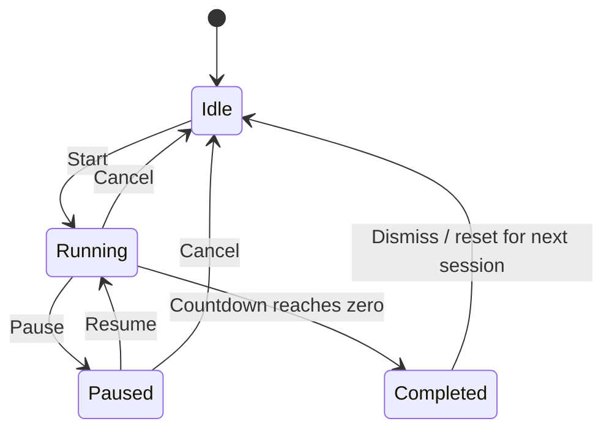
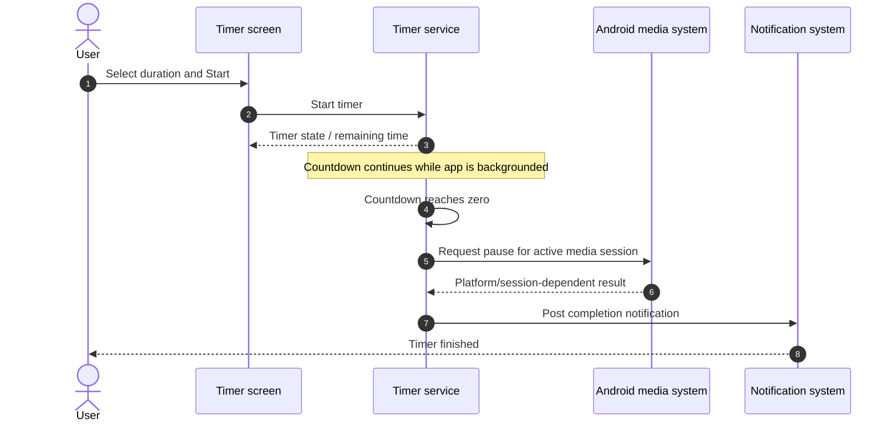
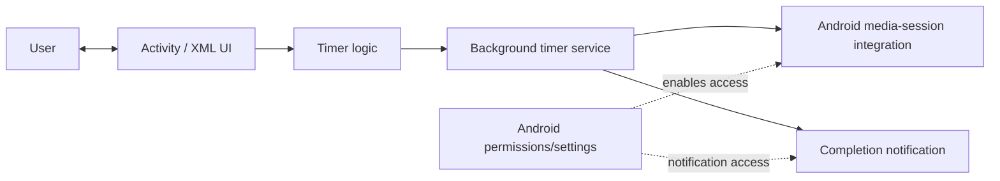
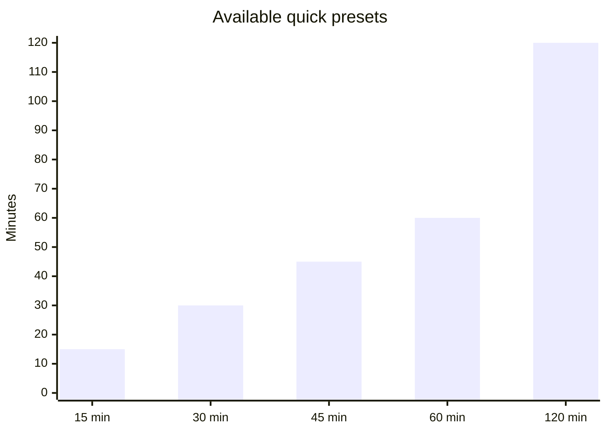
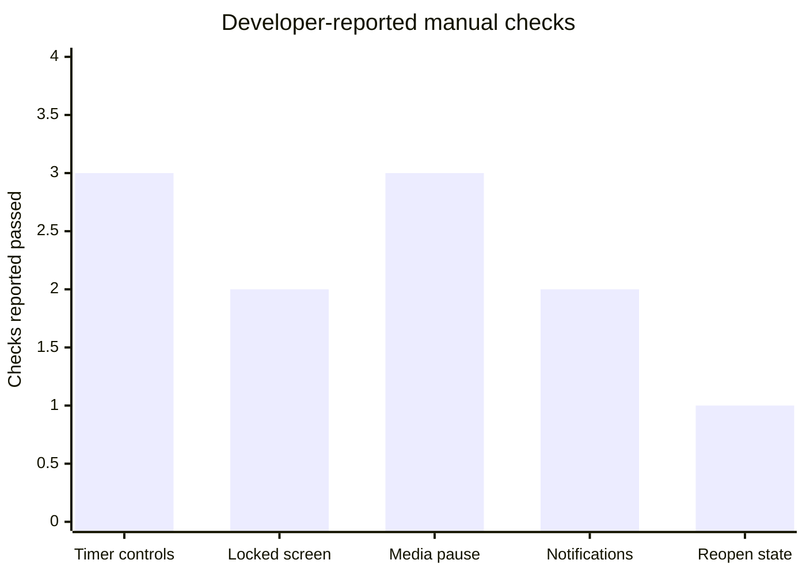
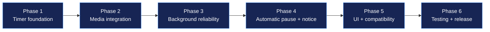

<div align="center">

# 🌙 Smart Sleep Timer

### Let your music wind down. Let yourself sleep.

A native Android sleep timer that counts down reliably, pauses supported media when the timer expires, and notifies you when the session is complete.

<p>
  
  
  
  
</p>

**A focused, offline-first Android project — no backend and no internet permission required.**

[Features](#-features) · [How it works](#-how-it-works) · [Permissions](#-permissions) · [Build](#-build-and-install) · [Test evidence](#-test-evidence) · [Roadmap](#-six-phase-build-journey)

</div>

---

## ✨ At a glance

| | |
|---|---|
| **App type** | Native Android application |
| **Implementation** | Java + XML layouts |
| **Build system** | Gradle / Android Studio |
| **Core workflow** | Select duration → start timer → media pauses at expiry |
| **Media integration** | Android media-session / notification-listener based integration |
| **Network dependency** | None required for the timer workflow |
| **Backend** | None |
| **Repository** | [Smart_Sleep-_Timer](https://github.com/ashrithBalaji456/Smart_Sleep-_Timer) |

> **Evidence note:** The test results in this README are recorded from the developer's reported manual tests on an iQOO Neo7 Pro running Android 16. They are not an independently audited test report. Add screenshots, screen recordings, and device/build details in the evidence section to make the results independently reviewable.

## 🚀 Features

- **Quick presets:** 15, 30, 45, 60, and 120 minutes.
- **Custom duration:** choose a timer duration for your own routine.
- **Timer controls:** Start, Pause, Resume, and Cancel.
- **Background countdown:** designed to continue while the screen is locked.
- **Media pause at expiry:** attempts to pause the active supported media session.
- **Completion notification:** alerts you when the timer finishes.
- **Permission-aware behavior:** handles notification permission denial and media-access setup.
- **No server required:** timer operation is local to the device.

## 🎬 How it works

### User journey


### Timer state model



### Expiry sequence



> Android media control depends on the active app/session, system version, and granted access. The app requests a pause; it cannot guarantee control of every possible player or device configuration.

## 🧭 Architecture



**Design principles**
- Keep the timer workflow local to Android.
- Separate the timer screen from background timing work.
- Use Android's permission and media-session mechanisms rather than a custom server.
- Treat media pause as a best-effort platform integration, not a universal guarantee.

## 📊 Timer presets



Presets are shortcuts; custom duration is available when a different interval is needed.

## 🧪 Test evidence

### Reported manual test matrix

The following results were reported by the developer during manual testing. Marked **PASS (reported)** means the developer says the check passed; it does not mean an external tester independently reproduced it.

| # | Test | Reported result |
|---:|---|---|
| 1 | App opens without crashing | PASS (reported) |
| 2 | Countdown starts and advances | PASS (reported) |
| 3 | Pause works | PASS (reported) |
| 4 | Resume works | PASS (reported) |
| 5 | Cancel works | PASS (reported) |
| 6 | Media access can be enabled | PASS (reported) |
| 7 | Manual media pause works | PASS (reported) |
| 8 | Countdown remains accurate with screen locked | PASS (reported) |
| 9 | Automatic pause at expiry works with Spotify | PASS (reported) |
| 10 | Automatic pause at expiry works with YouTube | PASS (reported) |
| 11 | Automatic pause at expiry works with Amazon Music | PASS (reported) |
| 12 | Completion notification appears only once | PASS (reported) |
| 13 | App handles notification permission denial | PASS (reported) |
| 14 | State is correct after leaving and reopening the app | PASS (reported) |
| 15 | Five-minute timer completes with default battery settings | PASS (reported) |

### Test coverage graph



This graph groups the reported checks by theme for readability; it is **not** a formal code-coverage percentage or an automated test metric.

### Add reproducible proof

For a portfolio-quality evidence trail, add these real artifacts to the repository and update the paths below:

| Evidence | Suggested file path | What it demonstrates |
|---|---|---|
| Main timer screen | `docs/screenshots/timer-home.png` | App UI and duration selection |
| Running countdown | `docs/screenshots/timer-running.png` | Timer in progress |
| Notification | `docs/screenshots/completion-notification.png` | Completion alert |
| Media pause test | `docs/screenshots/media-paused.png` | Player state after expiry |
| Full test recording | `docs/videos/end-to-end-test.mp4` | Start → lock screen → expiry → pause |
| Build proof | `docs/build/build-success.png` | Android Studio successful build |

**Do not add placeholder images and describe them as proof.** Capture genuine screenshots or a screen recording on your device, remove private notifications/personal information, and commit the artifacts before linking them here.

Example once files exist:

```markdown


```

### Useful edge cases to verify again before release

- Revoke media/notification access while the app is not running.
- Let the timer expire when no media player is active.
- Force-stop the app and check the documented behavior after reopening.
- Reboot the phone and verify whether any timer restoration is intended.
- Test battery saver / background restrictions on more than one Android device.
- Test a **release-signed APK**, not only the debug build.

## 🔐 Permissions

Actual permission declarations can vary with the source code and target SDK. Verify the final manifest before publishing this table as a literal manifest audit.

| Permission / access | Why it may be needed | User control |
|---|---|---|
| Notification permission (Android versions that require it) | Display timer completion notification | Can be denied in Android settings / prompt |
| Notification listener / media notification access, if implemented | Read active media notifications/session information for media control | Must be enabled by the user in system settings |
| Foreground-service permission/type, if declared by the app | Keep the timer service running according to Android rules | Governed by Android OS policy |

**Privacy statement:** The intended timer workflow does not need a backend or internet access. Confirm the final `AndroidManifest.xml` and dependency list before making a definitive security claim for a published build.

## 🛠️ Build and install

### Requirements

- Android Studio
- A compatible JDK configured by Android Studio / Gradle
- Android SDK components required by the project
- An Android device or emulator

### Open the project

1. Clone the repository:

   ```bash
   git clone https://github.com/ashrithBalaji456/Smart_Sleep-_Timer.git
   cd Smart_Sleep-_Timer
   ```

2. Open the project folder in Android Studio.
3. Allow Gradle sync to finish.
4. Connect an Android device or start an emulator.
5. Run the `app` configuration.

### Build a debug APK

**Windows PowerShell:**

```powershell
.\gradlew.bat assembleDebug
```

**macOS / Linux:**

```bash
./gradlew assembleDebug
```

Expected output location:

```text
app/build/outputs/apk/debug/app-debug.apk
```

The exact path can differ if the module or build variants are changed.

### Install on a connected Android device

With USB debugging enabled and the device authorized:

```bash
adb devices
adb install -r app/build/outputs/apk/debug/app-debug.apk
```

Only install APKs you built yourself or trust. Do not disable Android security protections to install an unknown APK.

### Create a signed release APK

1. In Android Studio, open **Build → Generate Signed Bundle / APK**.
2. Choose **APK** and continue.
3. Select an existing signing key or create a new keystore.
4. Choose the release build variant and finish.
5. Test the resulting release APK on the target device.
6. Keep the keystore and passwords private; **never commit them to GitHub**.

> Debug APKs are intended for development. Use a signed release build for distribution.


## 🧑‍🔧 Complete setup, USB testing, and installation troubleshooting

This section walks through the process on **Windows + Android Studio + a physical Android phone**. Menu names can vary slightly by Android Studio and phone manufacturer.

### 1. Set up the development environment

1. Install Android Studio from the official Android developer website: https://developer.android.com/studio
2. Open Android Studio and complete the setup wizard.
3. In **Tools → SDK Manager**, install the Android SDK platform and SDK Build-Tools required by this project. Install **Android SDK Platform-Tools** too; this package provides `adb`.
4. Clone the project:

   ```powershell
   git clone https://github.com/ashrithBalaji456/Smart_Sleep-_Timer.git
   cd Smart_Sleep-_Timer
   ```

5. In Android Studio, choose **Open** and select the project folder containing `settings.gradle` or `settings.gradle.kts`.
6. Allow Gradle sync to finish. If Android Studio asks to install a missing SDK component, review and install the required component.
7. Run **Build → Make Project**. Resolve any build error before trying to install the APK.

**If Gradle sync fails:** check your internet connection for the initial dependency download, use the JDK/Gradle configuration recommended by the project, and read the first meaningful error in the Build output. Avoid randomly upgrading Gradle, the Android Gradle Plugin, or dependencies just to silence an error.

### 2. Enable USB debugging on your Android phone

1. Unlock your phone and open **Settings → About phone**.
2. Find **Build number** (sometimes under Software information) and tap it seven times. Enter your phone PIN if requested.
3. Return to Settings and open **Developer options**.
4. Enable **USB debugging**.
5. Connect the phone to the computer using a USB cable that supports data transfer, not charging only.
6. Unlock the phone. If prompted, approve **Allow USB debugging** and verify the computer's RSA fingerprint only if you trust that computer.
7. If a USB notification appears, choose **File transfer / Android Auto** or another data-capable mode if needed by your device.

When finished testing on a computer you do not trust, turn USB debugging off and revoke debugging authorizations in Developer options.

### 3. Confirm that the computer can see the phone

Open Android Studio's Terminal, Windows PowerShell, or Command Prompt from the project folder.

```powershell
adb devices
```

If `adb` is not recognized, run it using the Android SDK path. A common Windows path is:

```powershell
& "$env:LOCALAPPDATA\Android\Sdk\platform-tools\adb.exe" devices
```

Interpret the result:

- `device` — connected and authorized.
- `unauthorized` — unlock the phone and approve the USB debugging prompt.
- No device listed — try another USB data cable/port, reconnect the phone, and check the phone's USB mode.
- `offline` — reconnect the device; if needed, restart ADB using the commands below.

```powershell
adb kill-server
adb start-server
adb devices
```

If Windows still cannot see the phone, install the appropriate USB driver from the phone manufacturer's official support source when one is required. Some devices use the Google USB Driver; many manufacturers provide their own driver. Do not download random driver bundles.

### 4. Build the debug APK

From the project root on Windows:

```powershell
.\gradlew.bat assembleDebug
```

Or use Android Studio's **Build → Build Bundle(s) / APK(s) → Build APK(s)** menu (wording may vary by version).

After a successful build, the expected APK path for the standard debug variant is:

```text
app\build\outputs\apk\debug\app-debug.apk
```

Confirm the file exists before trying to install it. If the build fails, fix the build error first; an APK cannot be installed if it was not generated successfully.

### 5. Install the app directly through USB (ADB)

With the phone connected, unlocked, and authorized:

```powershell
adb install -r "app\build\outputs\apk\debug\app-debug.apk"
```

If `adb` is not on PATH, use the full path:

```powershell
& "$env:LOCALAPPDATA\Android\Sdk\platform-tools\adb.exe" install -r "app\build\outputs\apk\debug\app-debug.apk"
```

- `-r` reinstalls the app while trying to preserve its app data.
- A successful install prints `Success`.
- To launch the app, use the phone's app drawer or click **Run** in Android Studio.

**Alternative: run from Android Studio.** Select your phone in the device selector, choose the `app` run configuration, and click **Run ▶**. Android Studio builds, installs, and launches the app. This is usually the easiest way to test code changes.

### 6. Install the APK without USB

If you need to share the APK with your own phone:

1. Build the APK and locate `app-debug.apk`.
2. Transfer it using a trusted method, such as USB file transfer, your own cloud storage, or a messaging app.
3. On the phone, open the APK from Downloads or the file manager.
4. If Android asks, allow **Install unknown apps** for that specific app (for example, the browser or file manager you used to open the APK), then return to the installer.
5. Review the package and install only if you trust the APK and know where it came from.
6. Turn off that “allow from this source” setting again if you no longer need it.

A debug APK is suitable for development and personal testing. For distributing a build to other people, prefer a properly signed release APK and share it from a trusted source.

### 7. Common installation problems and safe fixes

| Symptom | Likely cause | What to try |
|---|---|---|
| `adb` is not recognized | Platform-Tools is not on PATH | Use the full `adb.exe` path shown above or configure PATH to the SDK `platform-tools` folder |
| Device is missing from `adb devices` | Cable, USB mode, driver, or port issue | Use a data-capable cable, unlock the phone, change USB mode, try another port, install the official driver if needed |
| Device says `unauthorized` | Debugging approval not granted | Unlock the phone and approve the prompt; reconnect and run `adb devices` again |
| `INSTALL_FAILED_UPDATE_INCOMPATIBLE` | Installed app is signed with a different key | Install a build signed with the same key, or uninstall the old copy if you accept that its local app data may be removed |
| `INSTALL_FAILED_VERSION_DOWNGRADE` | APK version code is lower than installed version | Build/increment the version correctly, or uninstall the old app only if data loss is acceptable |
| `INSTALL_FAILED_NO_MATCHING_ABIS` | APK does not include a compatible native CPU architecture | Review native dependencies and build configuration; this app should not need native libraries unless a dependency adds them |
| `INSTALL_PARSE_FAILED...` | APK is corrupt, incomplete, or incompatible | Rebuild the APK, confirm the output file, and transfer it again |
| “App not installed” | Possible signature conflict, version issue, compatibility problem, or damaged transfer | Install through ADB to obtain a clearer error; check Android version and build output |
| Play Protect warning | Android has flagged an app or its behavior for review | Verify that you built the APK from your own source, inspect the warning, and use the official build. Do **not** disable Play Protect simply to bypass a warning |
| App installs but crashes | Runtime exception or device-specific issue | Run from Android Studio and inspect **Logcat** for the crash stack trace |
| Timer stops in background | Manufacturer battery management or service restrictions | Check app battery settings and test the intended foreground-service behavior; do not promise identical behavior across all devices |
| Media does not pause | No active compatible session, access disabled, or player/platform behavior | Enable the required media/notification access, start playback first, and test again; media control is best-effort |
| Completion notification is missing | Notification permission/channel disabled | Check Android app notification settings and the app's notification permission |

**Important:** Avoid “fixes” that require disabling Play Protect, installing unknown driver packages, or granting unrelated permissions. Prefer the exact error from ADB or Logcat and solve the underlying cause.

### 8. Capture evidence for your README

For a useful demo, record a short end-to-end test:

1. Show the timer home screen and selected duration.
2. Start the timer and show the countdown.
3. Lock the screen while the timer runs.
4. Let the timer expire while a supported media app is playing.
5. Show the media player paused and the completion notification.
6. Add screenshots to `docs/screenshots/` and a screen recording to `docs/videos/`.

Do not show personal messages, account details, or private notifications in public evidence. Include the phone model, Android version, APK variant, and date of testing so readers can understand the conditions.

### 9. Final release checklist

- [ ] Gradle sync and project build succeed.
- [ ] APK output exists and installs on the target phone.
- [ ] Start, pause, resume, cancel, and expiry are tested.
- [ ] Media access disabled / no active media / notification denied are tested.
- [ ] Background behavior and battery restrictions are checked.
- [ ] Signed release APK is tested separately from debug APK.
- [ ] Screenshots and recordings are genuine and committed to the repository.
- [ ] Keystore files, signing passwords, local secrets, and private data are excluded from Git.
- [ ] README instructions match the actual source code and manifest.

## 🗺️ Six-phase build journey

The project was developed in the requested six phases.



| Phase | Focus | Outcome |
|---|---|---|
| 1 | Timer foundation | Presets, custom duration, start/pause/resume/cancel |
| 2 | Media integration | Android media access and manual pause workflow |
| 3 | Background reliability | Countdown while the app is not in the foreground |
| 4 | Expiry behavior | Automatic media-pause request and completion notification |
| 5 | Polish and compatibility | UI refinement, permission/error handling, device testing |
| 6 | Verification and delivery | End-to-end tests, release build, APK delivery |

## 🧰 Technology stack

- **Java** — application logic
- **XML layouts** — Android user interface
- **Android SDK** — services, notifications, media integration, and permissions
- **Gradle** — build and dependency management
- **Android Studio** — development and build environment

No server-side framework or backend service is part of the intended design.

## 🧑‍💻 Portfolio summary

**Smart Sleep Timer — Native Android App**

Built a native Android sleep timer using Java and XML with configurable countdown presets, custom duration, pause/resume/cancel controls, background timing, media-pause integration, and completion notifications. Tested the core timer workflow and media pausing with Spotify, YouTube, and Amazon Music on an iQOO Neo7 Pro running Android 16 (developer-reported manual results). Designed the app to work locally without a required backend.

### Resume bullet

> Developed a native Android Sleep Timer using Java, XML, and Gradle, implementing configurable countdowns, background timer behavior, media-session pause integration, and completion notifications; validated key workflows through on-device manual testing.

## 🤝 Contributing

1. Fork the repository.
2. Create a feature branch.
3. Keep changes focused and test on a device/emulator.
4. Update this README when behavior, permissions, or supported Android versions change.
5. Open a pull request describing the change and the test evidence.

## 📄 License

No license has been specified here. Add a `LICENSE` file before presenting the project as open source, and choose a license whose terms you understand.

---

<div align="center">

**Built for quieter nights and a cleaner sleep routine. 🌙**

</div>
